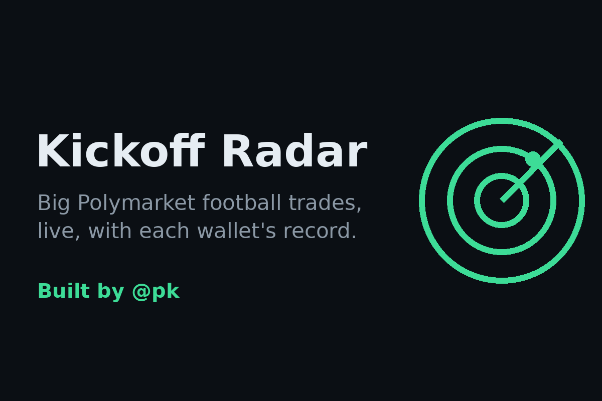
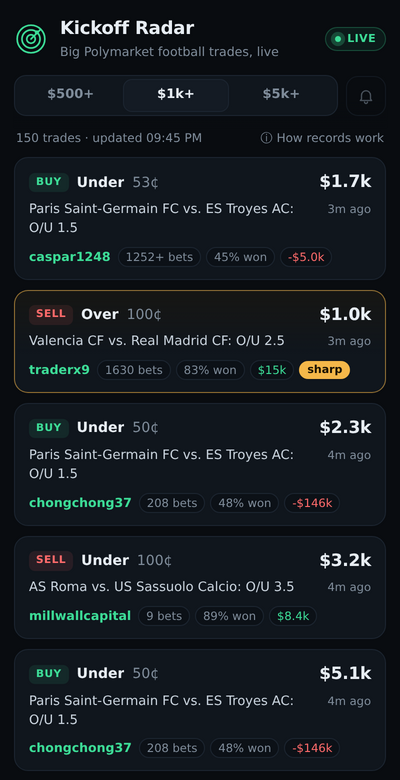

# Kickoff Radar

<p align="center">
  
</p>

<p align="center">
  <b>Big Polymarket football trades as they happen, with each wallet's football track record.</b><br>
  <a href="https://kickoff-radar.pedieth.workers.dev">Open the app</a> ·
  <a href="https://farcaster.xyz/pk">Farcaster mini app by @pk</a>
</p>

## What it does

- Live feed of football trades over $500, $1k or $5k, refreshed every 30 seconds.
- A football record for every wallet: resolved bets, win rate and PnL.
- **Sharp** wallets (20+ resolved bets, 60%+ won) are highlighted, with optional browser alerts when one trades.
- Every row is the taker side of a fill, so resting maker orders don't show up.
- Runs as a Farcaster mini app too: cast the link and it opens in the feed.

<p align="center"></p>

Plain HTML, CSS and JavaScript. No framework, no build step, no backend, no API keys.

## How it works

Everything runs in the browser against Polymarket's public APIs:

- **Gamma API** (`gamma-api.polymarket.com`) – `/events/keyset?tag_slug=soccer` sorted by 24h volume gives the open football events. Events for the same game (main market, "more markets", exact score…) share a `gameId`, so their volume is summed per match. `/sports` gives the league codes tagged as soccer, which is how trades are recognised as football (event slugs start with the league code, e.g. `epl-ars-che-2026-11-08`).
- **Data API v2** (`data-api.polymarket.com/v2`) – `/trades` for the global big-trade feed (`filter_type=CASH`) and per-event trades; `/positions` (`CLOSED` and `REDEEMABLE`) for wallet records.

One definition, so the numbers are not a mystery:

- **Football record** – a wallet's positions on football markets that have settled at 0 or 1. A bet counts as won if its total PnL is positive. For very active wallets only the most recent 2,000 closed positions are read, marked "(recent)". If a record can't be fetched it shows "—" rather than a guess. Records are cached in `localStorage` for 4 hours and fetched only for rows that scroll into view, two at a time.

## Run locally

```sh
python3 -m http.server -d docs
# open http://localhost:8000
```

Tests (Node 20+):

```sh
node --test
```

`node scripts/smoke.mjs` prints a few scored whale trades straight from the live APIs.

## Deploy

`.github/workflows/pages.yml` runs the tests and publishes `docs/` to GitHub Pages on every push to `main`.

`worker/index.js` is a small Cloudflare Worker that serves the same site from the root of `kickoff-radar.pedieth.workers.dev` and adds `/.well-known/farcaster.json`, the manifest Farcaster needs for the mini app.

## Disclaimer

Shows market activity, not betting advice. Big wallets can be wrong or hedging.

Data from Polymarket's public APIs. Not affiliated with Polymarket.

## License

MIT

---

Built by [@pk](https://farcaster.xyz/pk) · [pedieth](https://github.com/pedieth) · [@Pedi_eth](https://x.com/Pedi_eth)
